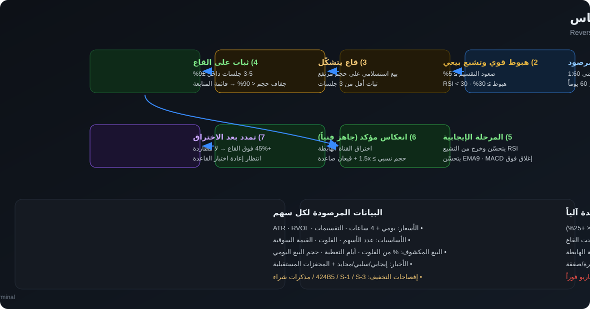

# 📡 منصة رصد التقسيم العكسي والانعكاس — RS Reversal Terminal

نظام رصد وتحليل فني احترافي للأسهم التي أُجري لها **تقسيم عكسي (Reverse Split)** خلال آخر شهرين،
ثم دخلت **موجة هبوط قوية** ووصلت إلى **تشبع بيعي (RSI < 30)** وكوّنت **قاعاً وثبتت عليه**،
فيرصدها النظام ويصنّفها في مراحل حتى تتحول إلى **فرصة انعكاسية جاهزة فنياً**.

المنصة تعمل كـ **لوحة داشبورد** (FastAPI + واجهة عربية RTL + Lightweight Charts) وتنفّذ
الاستراتيجية على **الفريم اليومي وفريم 4 ساعات** مع نماذج التحليل الفني الكلاسيكية.



---

## ⚡ التشغيل السريع

```bash
git clone <repo-url> && cd <repo>
./run.sh                      # ينشئ بيئة افتراضية + يثبّت المتطلبات + يشغّل الداشبورد
# ثم افتح:  http://localhost:8000
```

أو يدويًا:

```bash
python3 -m venv .venv && source .venv/bin/activate
pip install -r requirements.txt
cp .env.example .env           # الوضع الافتراضي: live (يتطلب اتصالاً بالمصادر المجانية)
python -m app.server           # http://localhost:8000
```

**وضع البيانات:**
| الوضع | الوصف | متطلبات |
|------|-------|---------|
| `demo` (اختبارات فقط) | بيانات سوق محاكية مولّدة داخليًا (سيناريوهات تمثّل الاستراتيجية بدقة، منها النموذج المرجعي JZ) | لا شيء |
| `live` | بيانات حقيقية: Yahoo Finance + SEC EDGAR + FINRA + RSS | انترنت |
| `auto` | مكافئ لـ `live` دون أي رجوع إلى الديمو | انترنت (اختياري) |

غيّر الوضع من `.env`: `RSS_DATA_MODE=live` ثم أعد تشغيل المخدم.

---

## 🎯 شروط الاستراتيجية المنفَّذة

| # | الشرط | المعيار في النظام |
|---|-------|-------------------|
| 1 | تقسيم عكسي حديث | نسبة **1:2 حتى 1:60** نافذة خلال **آخر 60 يومًا** |
| 2 | صعود يوم التقسيم | ≥ **5%** (المثالي 15%+) من سعر الافتتاح إلى قمة ما بعد التقسيم |
| 3 | موجة هبوط قوية | ≥ **30%** (جيد 40% / قوي 50%+) من القمة إلى القاع المرجعي |
| 4 | تشبع بيعي | **RSI < 30** (عميق < 25، متطرف < 20) |
| 5 | قاع وثبات | **3-5 جلسات** داخل نطاق ±9% حول القاع + **جفاف حجم** < 90% |
| 6 | تحسّن الزخم | RSI ≥ 35 أو +5 عن قاعه |
| 7 | تأكيد الانعكاس | إغلاقان فوق EMA9 + تحسّن MACD + **اختراق القناة الهابطة** + RVOL ≥ 1.5x |
| 8 | **ثبات على الدعم (أقلها 3 جلسات)** | عدد جلسات الثبات ≥ 3 داخل نطاق ضيق حول القاع ودون كسره |
| 9 | **الانطلاقة بعد الثبات** | صعود **≈ 20%** (يزيد أو يقل قليلًا، الحد الأدنى 15%) من إغلاق جلسات الثبات |
| 10 | **اختبار أقرب مقاومة** | مقاومة فعلية قريبة (≤ 25% من الدعم) **يتوقف** السعر عندها (فارق ≤ 3%) |
| 11 | **العودة لاختبار الدعم الرئيسي** | موجة عائدة تلامس الدعم الرئيسي (تسامح 2%) |
| 12 | **سحب سيولة تحت القاع ثم الاستعادة** | النمط البديل: فتيل يكسر الدعم ≥ 1% ثم إغلاق فوقه ≥ جلسة واحدة (+0.5%) |

**القاعدة الذهبية:** لا دخول أثناء الهبوط («لا نشتري سكينًا ساقطة») — الدخول بعد ثبات القاع **واكتمال دورة الحياة كاملة** (8-11) وتأكيد الاختراق.

> ⚠ أي كسر للدعم الرئيسي بعد الانطلاقة **دون** استعادة = فشل التسلسل وإلغاء السيناريو حتى يتكوّن قاع جديد.
> الشرطات 8-11 هي سبب تسمية المرحلة 6 بـ **«جاهز فنياً»**؛ بدونها يبقى السهم في المرحلة 5 (قيد التكوّن).
كسر القاع المرجعي بأكثر من 3% = **إلغاء السيناريو**.

📖 التفاصيل الكاملة: [`docs/STRATEGY.md`](docs/STRATEGY.md)

---

## 🧭 مراحل الرصد

```
1) تقسيم عكسي مرصود → 2) موجة هبوط وتشبع بيعي → 3) قاع يتشكّل
   → 4) ثبات على القاع (قائمة المتابعة) → 5) تحسّن RSI (المرحلة الإيجابية)
   → 6) انطلاقة ≈20% واختبار مقاومة قريبة → 7) عودة لاختبار الدعم الرئيسي أو سحب سيولة تحته ثم استعادته
   → 8) **جاهز فنياً** (اكتمال التسلسل) → 9) تمدد بعد الاختراق (لا مطاردة)
```

التصنيف آلي بالكامل، ولكل سهم **تقييم من 100** (A+ / A / B / C / D) مبني على 8 مكوّنات موزونة:
حدث التقسيم (18) · صعود التقسيم (8) · الموجة الهابطة (14) · التشبع البيعي (14) ·
القاع والثبات (18) · تأكيد الانعكاس (18) · عوامل الضغط والانفجار (6) · جودة المخاطر (4).

---

## 🔬 لوحة التحليل الفني (لكل سهم)

- **مخطط تفاعلي** (Lightweight Charts): شموع + EMA9/20/50/200 + بولنجر + قناة الانحدار،
  مع تبديل **يومي / 4 ساعات**، ومذبذبات **RSI / MACD / Stochastic / MFI / RVOL**،
  وعلامات على المخطط: تاريخ التقسيم، القمة، القاع، ونقطة الاختراق.
- **مطابقة الشروط** شرطًا بشرط (✅ / ⏳) مع القراءة الفعلية لكل شرط.
- **خطة التداول**: نقطة الاختراق، منطقة الدخول، الوقف التداولي، وقف إلغاء السيناريو،
  3 أهداف (38.2% / 61.8% / القمة) ونِسَب مخاطرة/عائد.
- **البيانات الأساسية**: عدد الأسهم، الفلوت، القيمة السوقية، متوسط السيولة.
- **البيع على المكشوف**: النسبة من الفلوت، أيام التغطية، تغيّر المراكز، ونسبة حجم البيع المكشوف اليومي.
- **الأخبار والمحفزات**: إيجابي/سلبي/محايد + **محفزات مستقبلية** (أرباح، طرح، امتثال، نتائج).
- **إفصاحات التخفيف** (424B5 / S-1 / S-3 / مذكرات شراء) مع درجة الخطورة.
- **النماذج الفنية**: وتد هابط، قناة هابطة، قاع مزدوج، قاعدة تجميع، جفاف حجم ثم انفجار،
  ديفرجنس RSI، قيعان صاعدة، شموع انعكاسية، علم صاعد، كوب وعروة، ضغط تقلب.

---

## 📄 النماذج التحليلية الجاهزة (عينات من مخرجات النظام)

| الملف | المحتوى |
|-------|---------|
| [`docs/samples/JZ_analysis_sample.md`](docs/samples/JZ_analysis_sample.md) · [HTML](docs/samples/JZ_analysis_sample.html) | **النموذج التحليلي الكامل** لسهم JZ (النموذج المرجعي: افتتاح 3.00$ → قمة 3.40$ → هبوط 52.9% → قاع 1.60$ → ثبات 5 جلسات → انطلاقة +23% إلى 2.05$ → مقاومة 2.01$ → سحب سيولة 1.53$ → استعادة 1.68$ ⇒ **جاهز فنياً** بتقييم 86.9 A+) |
| [`docs/samples/watchlist_sample.md`](docs/samples/watchlist_sample.md) · [HTML](docs/samples/watchlist_sample.html) | **راصد الفرص**: قائمة أفضل 7 فرص مرتّبة بالتقييم مع المستويات ونِسَب المخاطرة/العائد وأسباب الاستبعاد |

---

## 🖥️ لقطات من الواجهة

| التبويب | المحتوى |
|---------|---------|
| **الرصد والفرص** | جدول كل الأسهم مع المرحلة، التقييم، التقسيم، الصعود، الهبوط، جلسات الثبات، RSI، الفلوت، البيع المكشوف، نقطة الاختراق، مخاطرة/عائد ومؤشر التسلسل (6 خطوات) |
| **لوحة التحليل الفني** | التحليل الكامل للسهم المختار (مخططات + شروط + مستويات + نماذج + أخبار) |
| **مراحل الاستراتيجية** | شرح التسلسل + عدّاد لكل مرحلة + معادلة التقييم |
| **مصادر البيانات** | حالة كل مزوّد + مصادر البيانات المجانية + السيناريوهات التجريبية |
| **لوحة التحليل** | شريط دورة حياة (6 خطوات) + مخطط يومي/4H مع أدوات سحب وتكبير + قائمة الشروط + السرد + النماذج + الأخبار |
| **أدوات المخطط** | سحب حر باللمس/الفأرة، شريط سحب رأسي وأفقي، تكبير/تصغير رأسي وأفقي، تحجيم تلقائي، إظهار/إخفاء الحجم، وأسهم لوحة المفاتيح |
| **التنقّل** | زر «رجوع إلى الرادار» + دعم زر الرجوع في المتصفح (توجيه بالـhash) |
| **الجوال** | بطاقات فرص بدل الجدول العريض + رسم مصغّر لكل سهم + تبويبات ثابتة أعلى الشاشة + أزرار بمساحات لمس مناسبة |
| **الشروط على المخطط** | خطوط: الدعم الرئيسي ومنطقته، هدف الانطلاقة +20%، أقرب مقاومة، مستوى الاستعادة، قاع السحب + علامات الأحداث |
| **بثّ أحدث نسخة** | ملفات الواجهة تُقدَّم بلا تخزين مؤقت مع بصمة إصدار في الروابط، حتى لا يعرض المتصفح نسخة قديمة |

---

## 🗄️ مصادر البيانات (كلها مجانية بدون مفاتيح)

| المصدر | ما يقدّمه | الملف |
|--------|-----------|-------|
| **Yahoo Finance** (`yfinance`) | أسعار يومية + فريم 4 ساعات (تجميع 1h) + التقسيمات + الفلوت + البيع المكشوف + أخبار | `app/providers/yahoo.py` |
| **SEC EDGAR** | الإفصاحات الرسمية: 424B5/S-1/S-3 (طرح أسهم)، 8-K، 25-NSE (تقسيم عكسي)، NT (تأخير) | `app/providers/sec.py` |
| **FINRA Reg SHO** | نسبة حجم البيع المكشوف اليومية لكل رمز (ملفات `cdn.finra.org` المجانية) | `app/providers/finra.py` |
| **FINRA Bi-weekly** | مراكز البيع المكشوف نصف الشهرية (عند توفّر النسخة العامة) | `app/providers/finra.py` |
| **RSS** (Yahoo / Google News / Nasdaq) | الأخبار والمحفزات المستقبلية + تصنيف اتجاهي بالعربية | `app/providers/news.py` |
| **Demo Generator** | سيناريوهات محاكية كاملة (يومي + 4H متطابقان تمامًا) لتشغيل النظام كنموذج تحليلي مرجعي | `app/providers/demo.py` |

> ملاحظة: توفر بعض مصادر FINRA قد يتغيّر؛ البيانات الناقصة تُعرض صراحةً ولا تُستبدل بالديمو ويعرض حالة كل مزوّد في تبويب «مصادر البيانات».

---

## 🖱️ واجهة سطر الأوامر

```bash
python -m app.scanner --scan --mode live            # مسح الكون وطباعة جدول الرصد
python -m app.scanner --scan --only-watch           # قائمة المتابعة فقط
python -m app.scanner --symbols NIVF,CDT,GPUS --report    # تقارير Markdown/HTML/JSON لرموز محددة
python -m app.scanner --scan --json --out out.json  # ناتج JSON للأنظمة الأخرى
```

---

## 🔌 واجهة الـ API (مختصر)

```bash
curl -X POST "http://localhost:8000/api/scan/start?limit=60"     # ابدأ مسح السوق
curl "http://localhost:8000/api/scan/status"                     # نسبة التقدّم
curl "http://localhost:8000/api/scan/results?only_watch=true"    # جدول الفرص
curl "http://localhost:8000/api/analysis/JZ"                     # تحليل كامل لسهم
curl "http://localhost:8000/api/chart/JZ?tf=4H"                  # حِزمة الرسم
curl "http://localhost:8000/api/report/JZ?fmt=md"                # تقرير تحليلي
```

📖 المرجع الكامل: [`docs/API.md`](docs/API.md)

---

## 🏗️ بنية المشروع

```
app/
  config.py                معاملات الاستراتيجية وكل العتبات في مكان واحد
  server.py                FastAPI + مدير المسح في الخلفية + نقاط الـ API
  scanner.py               واجهة سطر الأوامر
  reporting.py             مولّد التقارير (Markdown → HTML عربي RTL)
  analytics/
    indicators.py          كل المؤشرات الفنية (RSI, MACD, ATR, Bollinger, قنوات, بنية السوق…)
    patterns.py            11 نموذجًا فنيًا مرتبطًا بالاستراتيجية
  providers/
    base.py                العقود والأنواع + كاش على القرص
    demo.py                مولّد البيانات التجريبية (سيناريوهات كاملة)
    yahoo.py, sec.py, finra.py, news.py     مزوّدو البيانات الحقيقية
    hub.py                 الدمج الحي دون بدائل تجريبية
  strategy/
    engine.py              قلب الاستراتيجية: الكشف، المراحل، التقييم، المستويات، السرد
    charting.py            تجهيز حِزم الرسوم للواجهة
web/                       الداشبورد (HTML/CSS/JS عربي + Lightweight Charts محليًا)
config/                    قوائم المراقبة والكون (CSV)
docs/                      ورقة الاستراتيجية + مرجع الـ API + مخطط التدفق
tests/                     57 اختبارًا (مؤشرات، استراتيجية، دورة الحياة وبواباتها، بيانات، API)
tools/
  daily_scan.py            المسح اليومي + بناء موقع النشر (يُشغّله GitHub Actions)
  make_snapshot.py         توليد «نسخة ثابتة» في ملف HTML واحد يعمل بلا مخدم
.github/workflows/
  ci.yml                   الاختبارات على كل push/PR
  daily-scan.yml           المسح المجدول ٣ مرات يوميًا + النشر على GitHub Pages
reports/output/            التقارير المولّدة (Markdown / HTML / JSON)
site/                      موقع النشر المبني تلقائيًا (index.html + dashboard.html + data/ + reports/)
```

---

## ✅ الاختبارات

```bash
python -m pytest          # 87 اختبارًا: المؤشرات، شروط الاستراتيجية، المراحل،
                          # التقييم، المستويات، سلامة البيانات وتطابق 4H مع اليومي،
                          # صرامة الوضع الحي، تغطية المسح (تعدد صفحات screener وحدود التغطية)،
                          # وكل نقاط الـ API
```

---

## 📱 رابط الداشبورد على الجوال + المسح اليومي التلقائي

اللوحة تُبنى وتُنشر تلقائيًا **من داخل المستودع** عبر GitHub Actions — بدون أي سيرفر خارجي:

- **رابط الجوال الثابت:** <https://omermasaad75-alt.github.io/-penny-stock-news-bot/>
  صفحة هبوط خفيفة فيها آخر تحديث + الملخّص + أفضل الفرص + روابط التقارير، ومنها زر **افتح اللوحة التفاعلية** (ملف واحد يعمل بلا إنترنت بعد فتحه أول مرة، ويمكن إضافته إلى الشاشة الرئيسية).
- **مواعيد المسح:** ٣ مرات كل يوم عمل — **16:35** و**20:05** و**00:15** بتوقيت الرياض
  (افتتاح السوق الأمريكي · منتصف الجلسة · بعد الإغلاق ببيانات إغلاق مستقرة).
- **بيانات حقيقية فقط:** الوضع `live` يستخدم Yahoo Finance + SEC EDGAR + FINRA + RSS.
  فشل الأسعار يستبعد الرمز؛ لا نشر لبيانات تجريبية ولا تعبئة لزيادة عدد الفرص.

**توليد الموقع يدويًا (نفس ما يفعله المسح المجدول):**

```bash
python3 tools/daily_scan.py --site site --limit 40 --mode live
# site/index.html       صفحة الهبوط (يدخل عليها الجوال)
# site/dashboard.html   اللوحة التفاعلية — ملف واحد يعمل بلا إنترنت
# site/data/latest.csv · latest.json   الجداول والبيانات
# site/history/ · site/reports/        السجل الزمني والتقارير التحليلية
```

- **سجل العمليات:** تبويب **Actions** → «المسح اليومي» — وكل عملية تحفظ نتائجها كـ Artifact لمدة 30 يومًا.
- **مسح فوري:** Actions → «المسح اليومي (Daily Scan)» → *Run workflow* (يمكن تحديد عدد الرموز ووضع البيانات).
- **مؤشر الحالة داخل المستودع:** [`docs/status/latest.json`](docs/status/latest.json) — يحدّثه كل مسح (الملخّص + أفضل الفرص + حالة المزوّدين + رابط العملية).

### كيف يُنشر الموقع؟ (مرة واحدة فقط)

كل تشغيل للمسح يدفع الموقع المبني كاملًا إلى فرع **`gh-pages`** تلقائيًا (صفحة الهبوط + اللوحة التفاعلية + البيانات + التقارير).
يبقى على GitHub تفعيل النشر مرة واحدة — لا يسمح GitHub لأي رمز آلي بذلك:

1. افتح: <https://github.com/omermasaad75-alt/-penny-stock-news-bot/settings/pages>
2. عند **Build and deployment → Source** اختر: **Deploy from a branch**
3. **Branch** = `gh-pages` و **Folder** = `/(root)` ثم **Save**

بعد دقيقة يصبح الرابط الثابت يعمل: <https://omermasaad75-alt.github.io/-penny-stock-news-bot/>
(بديل: اختر **Source = GitHub Actions** وسينشر الـ workflow تلقائيًا في المسح القادم.)

**رابط بديل فوري بدون أي إعداد** (مرآة CDN على نفس الفرع — قد يتأخّر تحديثها ساعات):
<https://cdn.jsdelivr.net/gh/omermasaad75-alt/-penny-stock-news-bot@gh-pages/index.html>

## 🧷 نسخة ثابتة تعمل بلا مخدم (Offline Snapshot)

لو تعذّر الوصول إلى المعاينة الحيّة، وُلِّد ملف واحد يحتوي اللوحة كاملة (البيانات + المخططات + التنسيق + الأكواد):

- الملف: [`docs/offline/rs_terminal_snapshot.html`](docs/offline/rs_terminal_snapshot.html) — افتحه بالنقر المزدوج في أي متصفح، بلا إنترنت وبلا تثبيت.
- لتحديثه بعد أي تعديل: `python3 tools/make_snapshot.py` (يقرأ من `http://localhost:8000`).
- صور من الواجهة: [`docs/screenshots/`](docs/screenshots) (رادار سطح المكتب، بطاقة سهم، الجوال، والنسخة الثابتة).

## ⚠️ إخلاء المسؤولية

هذه المنصة **أداة تحليل فني وكمّي وليست نصيحة استثمارية**.
أسهم التقسيم العكسي عالية المخاطر جدًا: احتمال شطب من البورصة، تخفيف متكرر للأسهم،
وسيولة ضعيفة وتقلب عنيف. استخدم إدارة مخاطر صارمة (0.5%-1% مخاطرة لكل صفقة)
ولا تخاطر بأكثر مما تتحمل خسارته.

## 📄 الرخصة

MIT — راجع ملف `LICENSE` (مكتبة الرسوم TradingView Lightweight Charts مرخّصة Apache-2.0، وملف رخصتها في `web/vendor/`).


### حاجز النشر الحي

- الكون يُكتشف من Yahoo screener **متعدد الصفحات** (أسهم أمريكية بسعر > 0 وحتى سقف سعر
  الاستراتيجية `STRATEGY.max_price`، مرتبة بالنشاط)، مع **سقف قابل للضبط**
  `RSS_UNIVERSE_MAX_CANDIDATES` (افتراضي 1000 مرشح، حتى 100 رمز لكل صفحة).
- القوائم اليدوية (`config/watchlist.csv` و`config/universe.csv`) تُضاف كمرشحين **يحتاجون
  التحقق** وليست إثباتاً لصلاحية الرمز؛ شرط حجم اليوم لا يُستخدم في اكتشاف المرشحين —
  فحص السيولة الاستراتيجي يبقى داخل التحليل كما هو.
- تُفحص الأسعار وحداثتها ثم تقسيم عكسي مؤكد خلال 60 يوماً بنسبة 1:2–1:60.
  تجاهل حدث تقسيم **تاريخي** لا يُبطل أهلية حدث حديث صالح؛ يُسجَّل كملاحظة «حدث تاريخي متجاهَل».
- `--limit` حد الرموز المطابقة المحللة، وليس عدد المرشحين قبل الفلترة.
- **شفافية حدود التغطية:** `sources.candidate_discovery` يعلن نطاق screener وسقف السعر
  وإجمالي المطابقات (إن توفر) وعدد الصفحات وهل جرى اقتطاع النتائج (`truncated` — لا يصبح
  False إلا عند الوصول الفعلي لنهاية النتائج). و`sources.scan_coverage` يعلن عدد المرشحين
  المجموعين والمفحوصين وغير المفحوصين و`partial` و`stop_reason`. الرموز التي لم تُفحص
  (انتهاء مهلة الاكتشاف 15 دقيقة أو بلوغ `--limit`) تُصنَّف «لم يُفحص» وليست مستبعدة فنياً.
- صفحة الهبوط واللوحة يعرضان هذه الأرقام ويفرّقان بوضوح بين: لم يُفحص · بيانات غير متاحة ·
  لا تقسيم حديث مطابق · تقسيم حديث مرصود لكنه غير مؤهل فنياً · قائمة المتابعة · جاهز فنياً.
  وعند جزئية التغطية يظهر تحذير أصفر: «التغطية جزئية؛ لا تعني النتائج غياب حالات أخرى في
  السوق خلال شهرين». رفع السقف يوسّع التغطية ولا يجعلها جرداً كاملاً لكل السوق.
- `sources.candidates_checked` و`verified_symbols` يوضحان حجم الفحص الحقيقي؛ `excluded` يسجل أسباب الاستبعاد.
- كل صف يحمل المصادر الأربعة و`synthetic`. المصادر الاختيارية غير المتاحة تبقى فارغة وتظهر «ناقص»؛ لا نختلق مصدرها.
- `python tools/validate_live.py site/data/latest.json` يفشل عند أي مصدر تجريبي أو صف بلا أسعار/أساسيات موثقة.
- الديمو في أداة البناء يتطلب `--test-only` للاختبار المحلي؛ ممنوع حتى بهذا العلم داخل Actions.
- الأيقونة والمانيفست تُنسخان إلى `site/` تلقائياً؛ `dashboard.html` ملف مولّد وليس ملفاً متتبعاً.
- لا توجد معاينة حية مطلوبة. الميزانية الزمنية لسير العمل 30 دقيقة؛ للاكتشاف 15 دقيقة.
